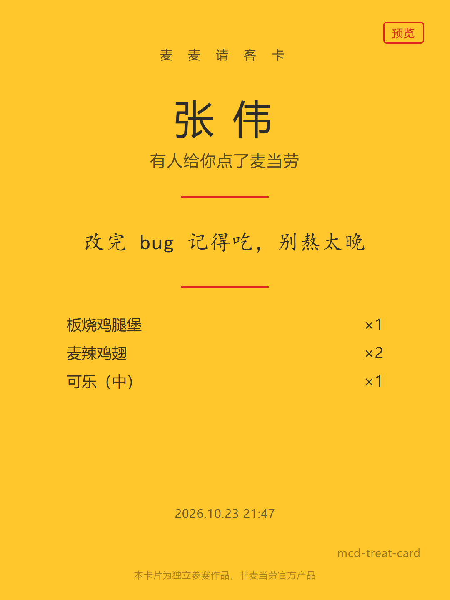

# 麦麦请客卡 · McTreat

> 用你的账号，给加班的同事 / 异地的对象 / 明天考试的室友点一份麦当劳，
> 生成一张能直接发微信的请客卡。

**请客不是省钱，是为了那句"我记得你"。**



---

## 它解决什么

麦当劳 MCP 开放了 33 个工具，把「读菜单 → 算价 → 建单 → 返回支付链接」整串挂到了 Agent 可调的接口上。
但已有 100 多个参赛项目几乎全在做同一件事：**怎么让自己这顿更便宜**。

McTreat 做的是另一件事：**怎么用这顿饭替你把一句话送到别人手上。**

关键差别在组单逻辑上——

| 场景 | 省钱工具 | McTreat |
|---|---|---|
| 满 40 减 8，你只想送 30 的东西 | 凑到 40，多买填满减 | **不凑**。多花几块，送得干净 |
| 凑单物 | 最便宜的填充物 | 只有本身是合理组成部分时才凑 |
| 目标函数 | 总价最小 | 体面度最大 |

因为收卡的人看得见卡片上的订单明细。为了满减塞两个甜筒进去，
送的人省了 8 块，收的人看到的是"敷衍"。

---

## 目标用户

- 想给异地对象 / 父母点一份早餐的人
- 想给加班同事点份夜宵但不好意思直接问地址的人
- 想用一顿麦当劳道歉、破冰、表达"我记得你"的人
- 1024 期间想给改 bug 的兄弟点一份的程序员

---

## 安装

### 1. 申请 MCP Token

打开 https://open.mcd.cn/mcp ，手机号登录 → 右上角「控制台」→ 激活 → 复制 Token。

> Token 代表你的麦当劳会员身份。**严禁分享，严禁提交进公开仓库。**

### 2. 接入 MCP

仓库里的 `mcp-config.example.json` 内容如下，把 `${MCD_MCP_TOKEN}` 换成真实 Token：

```json
{
  "mcpServers": {
    "mcd-mcp": {
      "type": "streamablehttp",
      "url": "https://mcp.mcd.cn",
      "headers": { "Authorization": "Bearer ${MCD_MCP_TOKEN}" }
    }
  }
}
```

官方 README 推荐客户端：WorkBuddy、Cherry Studio、Cursor、Kiro、Trae、VSCode。

两个硬约束：每 Token 每分钟最多 600 次请求（超限 429）；客户端必须支持 Streamable HTTP。

### 3. 安装依赖

```bash
pip install httpx playwright
playwright install chromium
```

业务逻辑只依赖标准库，Playwright 仅用于卡片渲染。

### 4. 放好 Token

在项目根目录创建 `.env` 文件（复制 `.env.example` 改名即可），内容一行：

```
MCD_MCP_TOKEN=你的Token
```

`.env` 已被 `.gitignore` 排除，不会进公开仓库。脚本运行时自动读取，
不需要导出环境变量——**这样 Token 就不会出现在命令行、终端历史和任何工具的输出里。**

备选方式（不落盘，但每次新开终端都要重设）：

```powershell
$env:MCD_MCP_TOKEN = "你的Token"
```

---

## 使用示例

在接入了 `mcd-mcp` 的 WorkBuddy 里直接说：

```
给在上海张江上班的同事点份夜宵，预算 40，他今晚加班改 bug
```

Agent 会走完下面的流程：

```
你名下还没有可配送地址，我帮你加一个。请给我：省市区 + 详细地址 + 收件人 + 手机号

（用户提供后）

张江科苑店可配送，给你三套：

A｜深夜续命组 · ¥38.00
   麦香鱼 1 + 中薯条 1 + 美式咖啡（大）1
   提神扛饿，改完 bug 正好垫一口

B｜体面饱腹组 · ¥42.00
   板烧鸡腿堡 1 + 麦辣鸡翅 2 块 + 可乐（中）1
   热食送到手还是热的，吃得饱

C｜轻量夜宵组 · ¥26.00
   麦旋风 1 + 薯条（小）1 + 热牛奶 1
   不重，睡前吃没负担

（本单不为你凑满减——送人送得干净比省 8 块重要。）

（用户选 B，写祝福语）

预览卡做好了，你看下效果。确认的话我就下单。

（用户确认）

订单已建好，请打开链接付款：https://...
（钱是你自己扫的，我不会替你付）

（用户付款后）

卡片好了。订单号尾号 3721，预计 23:10 前送达。直接发给张伟就行。
```

卡片产出 1080×1440 PNG：

- 预览卡：付款前确认视觉效果，带红色「预览」角标
- 正式卡：付款后生成，含订单尾号与预计送达时间

---

## 用到的 MCP 工具

详见 [MCP_INTEGRATION.md](MCP_INTEGRATION.md)。

核心链路 13 个工具，其中**唯一的写操作是 `create-order`**，且必须用户显式确认后才触发。

---

## 目录结构

```
mcd-treat-card/
├─ SKILL.md                  Skill 定义：行为契约、组单规则、安全约束
├─ scripts/
│   ├─ mcp_client.py         MCP Streamable HTTP 传输层（协议级，零业务字段）
│   ├─ probe.py              接口侦察：取回官方 README 缺失的 inputSchema
│   ├─ card_render.py        卡片模板 → 1080×1440 PNG
│   └─ treat.py              主流程编排
├─ templates/card.html       卡片模板（string.Template，无额外依赖）
├─ fixtures/                 接口真实返回样本（真实数据不入库）
├─ tests/                    离线自测（不消耗真实调用额度）
├─ README.md
├─ CONTEST_DECLARATION.md    参赛声明，官方原文
├─ MCP_INTEGRATION.md
├─ mcp-config.example.json
└─ workbuddy.md
```

---

## 实测接口事实

官方 README 只有 33 个工具名和一句描述，**没有入参 schema，且部分内容已过时**。
本项目第一天做的是接口侦察：从 MCP 协议的 `tools/list` 取回真实 `inputSchema`，
再逐个真机调用验证返回结构。

完整清单见 **[docs/接口事实清单.md](docs/接口事实清单.md)**，以下是最要命的几条：

### 1. 响应不是 JSON，是 Markdown 文档包 JSON

```
每个门店的基本信息按单行展示：        <- 给模型看的展示指令
- **门店名称**: data[].storeName
{"success":true,"code":200,"data":{...}}   <- 真正的 JSON，位置不固定
```

JSON 位置三种形态都有（有标记 / 无标记 / `data` 本身是 Markdown），
所以必须做括号平衡扫描，不能 `split` 或依赖固定标记。
上游信封是 `{"success","code","message","traceId","data"}`。

### 2. 工具实际 35 个，不是文档说的 33 个

且文档有两个**拼写错误**，照抄必失败：

| 文档写的 | 实际是 |
|---|---|
| `query-partystore-date` | `query-party-store-date` |
| `query-partystore-session` | `query-party-store-session` |

### 3. 三个文档没写的隐含约束

| 约束 | 后果 |
|---|---|
| `query-nearby-stores` 的 **city 与 keyword 必须同时传** | 只传一个 → `600058 城市名或者关键词不能为空` |
| **外送(orderType=2)场景 `beCode` 必传** | schema 标"选填"，不传会失败 |
| **选店要先按 `businessStatus` 过滤** | 对打烊门店调 `query-meals` → `600057 门店可能已关闭` |

### 4. 单位不一致

`query-meals` 的 `currentPrice` 是**字符串、单位「元」**；
`calculate-price` 返回**「分」**。混用会差 100 倍。

### 5. 会话是无状态的

`initialize` 不返回 `Mcp-Session-Id`，每次请求独立，不要依赖会话头。

---

## 测试

```bash
python -m tests.test_parsers
python -m tests.test_recommender
```

全部基于 `fixtures/` 离线运行，**不消耗真实调用额度**。

---

## 免责声明

本项目为独立参赛作品，由参赛者独立开发，非麦当劳官方产品，也未获得麦当劳品牌背书。
卡片与文档中展示的数据均来自麦当劳中国 MCP 接口返回，仅供参考；
活动规则、价格、供应状态以麦当劳官方渠道的实时结果为准。
对「麦当劳」名称的使用仅限描述性指代，不构成商标授权，亦不暗示官方背书。

---

## License

MIT
